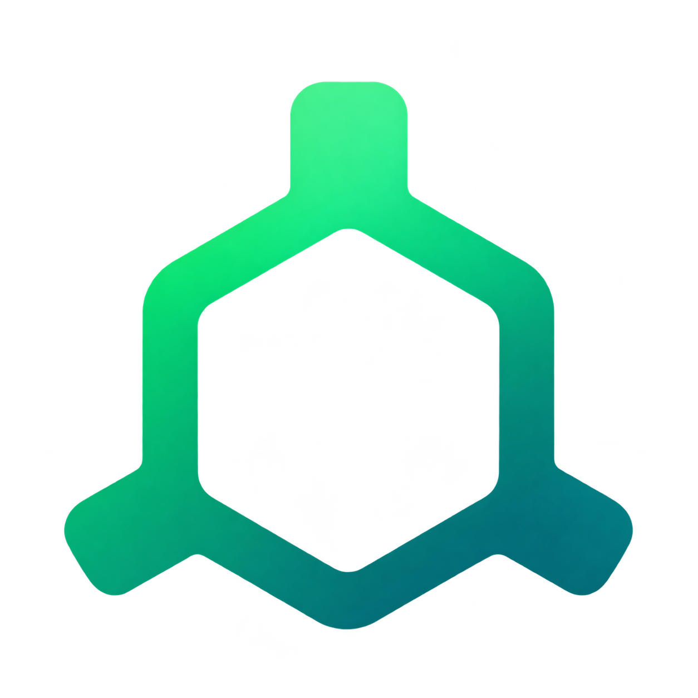

<p align="center">
  
</p>

# LocalHub

[English](#english) · [Türkçe](#türkçe)

## English

LocalHub is a macOS app that gives paired phones, tablets, and computers a single entry point to AI services running on a Mac. It brings local chat models, ComfyUI workflows, and Model Context Protocol (MCP) tools together behind one API. The Mac app manages integrations, device access, and jobs from a window and stays available in the menu bar.

**LocalHub was developed entirely with AI, under human direction.** It is an independent project built for learning and experimentation, with no commercial purpose. LocalHub began as ArtBlend's Mac Companion and now supports other client apps and scripts through its own API and SDKs.

### What LocalHub does

| Area | Features |
| --- | --- |
| Integrations | Connect LM Studio, Ollama, or another compatible local model server for chat and embeddings. Import ComfyUI workflows for image, audio, video, or 3D tasks, depending on the configured workflow and installed models. |
| Device access | Pair with a QR code or enter the address, certificate fingerprint, and code manually. Manage access by capability and device, apply policies and quotas, and revoke a device from the Mac. |
| MCP tools | Configure MCP servers and choose which tools paired devices can see and use. Access is granted per server. |
| Playground | Try multi-turn chat, visual prompts, and workflow parameters on the Mac. Inspect or save generated output. |
| Jobs and files | Monitor long-running jobs, configure priorities and night scheduling, and manage device-owned files. Inspect saved workflow recipes and replay them or make a seed variation. |
| Usage and diagnostics | Review request counts, timing, and errors separately from chat history. Check local services, certificates, permissions, and storage through diagnostics. |

LocalHub defaults to loopback access. Enable local network access in Settings when pairing another device. Clients verify the hub's certificate fingerprint before sending credentials, then use a bearer token for authorized requests. LocalHub saves its app state in `~/Library/Application Support/LocalHub`.

### Build and run on macOS

Use macOS **14 or later** and a **Swift 6** toolchain with Xcode command-line tools. Run these commands from the repository root.

```sh
./scripts/make-app.sh
open build/LocalHub.app
```

The script builds an ad hoc signed release app. Pass `--debug` to build a debug app. After launch, use Setup Guide or Integrations to configure your local services. For media generation, add a compatible workflow from **Workflows → Import Workflow**, or try one of the [sample ComfyUI workflows](examples/workflows/). Each workflow requires its own models and nodes.

The headless executable provides an alternative to the desktop app. Run one at a time when using the same state directory.

```sh
(cd hub && swift run localhub)
```

### Integrate a client

1. Open **Pair a Device** in LocalHub and scan the QR code in the client, or enter the connection details by hand.
2. Use an SDK to verify the TLS certificate fingerprint and exchange the one-time code at `POST /v2/pair`. Store the issued token in the platform's secure storage.
3. Query `GET /v1/models` and use the routes the device is permitted to call. Chat uses an OpenAI-compatible request shape. Pairing, device events, and MCP tools have LocalHub-specific routes.

| Client | SDK |
| --- | --- |
| Node.js and the Electron main process | [TypeScript](clients/typescript/) |
| Flutter and Dart apps such as ArtBlend | [Dart](clients/dart/) |
| Native iOS and macOS apps | [Swift](clients/swift/) |
| Android and JVM apps | [Kotlin](clients/kotlin/) |

The [OpenAPI specification](api/openapi.yaml) is also served by a running hub at `GET /v2/openapi.yaml`. After editing the specification, run `./scripts/sync-openapi.sh` to update the version embedded in the Swift binary.

### Repository layout and tests

- [`hub/`](hub/) contains the SwiftUI app, Vapor service, command-line executable, and Swift tests.
- [`clients/`](clients/) contains the client SDKs, usage examples, and SDK tests.
- [`api/`](api/) contains the API contract. [`examples/workflows/`](examples/workflows/) contains importable workflows used by examples and tests.
- [`scripts/`](scripts/) contains app packaging and OpenAPI sync scripts.

```sh
(cd hub && swift test)
(cd clients/typescript && pnpm install && pnpm test && pnpm typecheck)
(cd clients/dart && dart pub get && dart test && dart analyze)
./clients/kotlin/scripts/test.sh
```

### Origins and references

- ArtBlend's Mac Companion was the starting point for pairing and device access. [ArtBlend](https://github.com/ErdemYesiltas/ArtBlend)
- Local model serving and discovery shaped the integration design. [LM Studio](https://lmstudio.ai/docs/developer) · [Ollama](https://docs.ollama.com/)
- Node-based media generation and reusable workflow graphs informed the workflow importer. [ComfyUI](https://docs.comfy.org/)
- The standard for exposing tools and their argument schemas guides the MCP integration. [Model Context Protocol](https://modelcontextprotocol.io/)

### License

LocalHub and its SDKs are available under the [MIT License](LICENSE).

## Türkçe

LocalHub, eşleştirilmiş telefonların, tabletlerin ve bilgisayarların bir Mac’te çalışan yapay zekâ servislerine tek noktadan bağlanmasını sağlayan bir macOS uygulamasıdır. Yerel sohbet modellerini, ComfyUI iş akışlarını ve Model Context Protocol (MCP) araçlarını tek API üzerinden sunar. Entegrasyonlar, cihaz erişimi ve işler Mac uygulamasının penceresinden yönetilir. Pencere kapandığında uygulama menü çubuğundan erişilebilir.

**LocalHub, insan yönlendirmesiyle tamamen yapay zekâ kullanılarak geliştirildi.** Öğrenme ve deneme amacıyla geliştirilen bağımsız bir projedir ve herhangi bir ticari amaç gütmez. ArtBlend'in Mac Companion bileşeninden doğan LocalHub, kendi API'si ve SDK'larıyla başka uygulamalara ve betiklere de hizmet verir.

### LocalHub neler yapar?

| Alan | Özellikler |
| --- | --- |
| Entegrasyonlar | Sohbet ve vektör temsilleri için LM Studio, Ollama veya başka bir uyumlu yerel model sunucusu bağlayın. Yüklü modellere ve iş akışına bağlı olarak görsel, ses, video veya 3B üretim için ComfyUI iş akışları içe aktarın. |
| Cihaz erişimi | QR kodla eşleştirin veya adresi, sertifika parmak izini ve kodu elle girin. Cihaz başına yetenekleri, erişim kurallarını ve kotaları yönetin. Mac üzerinden cihaz erişimini iptal edin. |
| MCP araçları | MCP sunucularını yapılandırın ve eşleştirilmiş cihazların hangi araçları görüp kullanabileceğini seçin. Erişim sunucu bazında verilir. |
| Deneme alanı | Mac’te çok turlu sohbeti, görsel istemleri ve iş akışı parametrelerini deneyin. Üretilen çıktıları inceleyin veya kaydedin. |
| İşler ve dosyalar | Uzun süren işleri takip edin, öncelikleri ve gece planlamasını ayarlayın ve cihaza ait dosyaları yönetin. Kaydedilen iş tariflerini inceleyin, aynı tarifi yeniden çalıştırın veya farklı bir seed ile varyasyon üretin. |
| Kullanım ve tanılama | İstek sayısı, süre ve hata bilgilerini sohbet geçmişinden ayrı inceleyin. Yerel servisleri, sertifikaları, izinleri ve depolamayı tanılama ekranından kontrol edin. |

LocalHub varsayılan olarak yalnızca Mac'in kendisinden gelen bağlantıları kabul eder. Başka bir cihaz eşleştirmek için Ayarlar'dan yerel ağ erişimini açın. İstemciler kimlik bilgisi göndermeden önce sunucunun sertifika parmak izini doğrular, ardından yetkili isteklerde erişim anahtarını kullanır. Uygulama verileri `~/Library/Application Support/LocalHub` altında saklanır.

### macOS'ta derleme ve çalıştırma

**macOS 14 veya üzeri**, **Swift 6** ve Xcode komut satırı araçları gerekir. Komutları deponun kök dizininden çalıştırın.

```sh
./scripts/make-app.sh
open build/LocalHub.app
```

Betik ad hoc imzalı bir release derlemesi üretir. Debug derlemesi için `--debug` parametresini ekleyin. Uygulamayı açtıktan sonra kurulum rehberinden veya Entegrasyonlar ekranından yerel servisleri yapılandırın. Medya üretimi için **Workflows → Import Workflow** üzerinden uyumlu bir iş akışı ekleyin veya [ComfyUI örneklerini](examples/workflows/) deneyin. Her iş akışı kullandığı model ve düğümlerin kurulu olmasını gerektirir.

Grafik arayüz yerine komut satırı sürümü de kullanılabilir. Aynı veri dizinini kullanıyorsanız bunlardan birini çalıştırın.

```sh
(cd hub && swift run localhub)
```

### İstemci entegrasyonu

1. LocalHub’da **Pair a Device** penceresini açıp QR kodu istemciyle tarayın veya bağlantı bilgilerini elle girin.
2. SDK ile TLS sertifikasının parmak izini doğrulayın ve tek kullanımlık kodu `POST /v2/pair` üzerinden değiştirin. Verilen erişim anahtarını platformun güvenli depolama alanında saklayın.
3. `GET /v1/models` ile modelleri sorgulayın ve cihazın erişimine açık uç noktaları çağırın. Sohbet, OpenAI ile uyumlu bir istek biçimi kullanır. Eşleştirme, cihaz olayları ve MCP araçları LocalHub’a özgü uç noktalara sahiptir.

| İstemci | SDK |
| --- | --- |
| Node.js ve Electron ana süreci | [TypeScript](clients/typescript/) |
| ArtBlend gibi Flutter ve Dart uygulamaları | [Dart](clients/dart/) |
| Yerel iOS ve macOS uygulamaları | [Swift](clients/swift/) |
| Android ve JVM uygulamaları | [Kotlin](clients/kotlin/) |

[OpenAPI şeması](api/openapi.yaml), çalışan LocalHub'da `GET /v2/openapi.yaml` üzerinden de sunulur. Şemayı düzenledikten sonra Swift derlemesine gömülen kopyayı güncellemek için `./scripts/sync-openapi.sh` çalıştırın.

### Depo yapısı ve testler

- [`hub/`](hub/) SwiftUI uygulamasını, Vapor servisini, komut satırı aracını ve Swift testlerini içerir.
- [`clients/`](clients/) istemci SDK'larını, kullanım örneklerini ve SDK testlerini içerir.
- [`api/`](api/) API sözleşmesini içerir. [`examples/workflows/`](examples/workflows/) örneklerde ve testlerde kullanılan, içe aktarılabilir iş akışlarını barındırır.
- [`scripts/`](scripts/) uygulama paketleme ve OpenAPI eşitleme betiklerini içerir.

```sh
(cd hub && swift test)
(cd clients/typescript && pnpm install && pnpm test && pnpm typecheck)
(cd clients/dart && dart pub get && dart test && dart analyze)
./clients/kotlin/scripts/test.sh
```

### Projenin kökeni ve referanslar

- Eşleştirme ve cihaz erişiminin başlangıç noktası Mac Companion bileşeniydi. [ArtBlend](https://github.com/ErdemYesiltas/ArtBlend)
- Yerelde model sunma ve keşfetme özellikleri entegrasyonların tasarımına yön verdi. [LM Studio](https://lmstudio.ai/docs/developer) · [Ollama](https://docs.ollama.com/)
- Düğüm tabanlı medya üretimi ve yeniden kullanılabilen iş akışları, içe aktarma tasarımına örnek oldu. [ComfyUI](https://docs.comfy.org/)
- Araçları ve argüman şemalarını sunma standardı MCP entegrasyonuna yön verdi. [Model Context Protocol](https://modelcontextprotocol.io/)

### Lisans

LocalHub ve istemci SDK'ları [MIT Lisansı](LICENSE) ile yayımlanır.
